

<picture>
  <source media="(prefers-color-scheme: dark)" srcset="docs/assets/carlink-mark-dark.svg">
  <source media="(prefers-color-scheme: light)" srcset="docs/assets/carlink-mark-light.svg">
  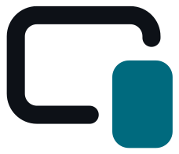
</picture>

# CarLink

**CarPlay and Android Auto in one app, for any Android car stereo or tablet.**

[-3DDC84?logo=android&logoColor=white)](#requirements)

[**Download**](https://github.com/F-e-n-y-x/CarLink/releases/latest) ·
[Install](#install) · [User guide](docs/USER_GUIDE.md) ·
[Troubleshooting](docs/TROUBLESHOOTING.md) · [Docs](docs/README.md)

Install CarLink on an Android car stereo, or on an Android tablet or phone used as the car's
display. Plug in or connect your phone: an **iPhone gets CarPlay**, an **Android phone gets
Android Auto**, by cable (USB) or wirelessly. CarLink works out which phone it is; there is
nothing to choose.

CarLink is generic: it is meant for any Android head unit or tablet, not one car brand. It
combines two open-source engines, imported with their full history: **DiPlay** (CarPlay) and
**DiAuto** (Android Auto), both written for BYD DiLink head units; their BYD-only features stay
off unless you pick BYD as the car brand.

<table>
  <tr>
    <td width="50%"><a href="docs/screenshots/home/home_ready-iphone-usual_tablet_dark.webp">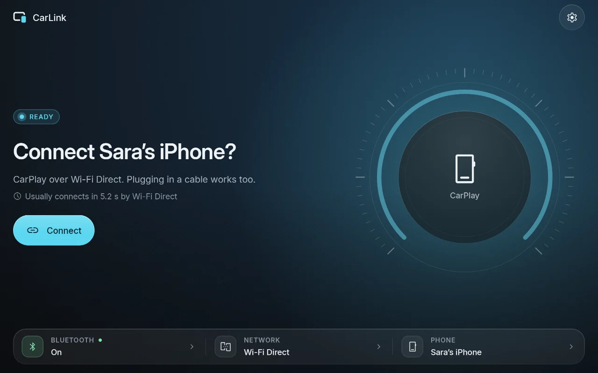</a> Home: one status, one action</td>
    <td width="50%"><a href="docs/screenshots/home/home_connecting-carplay-usb_tablet_dark.webp">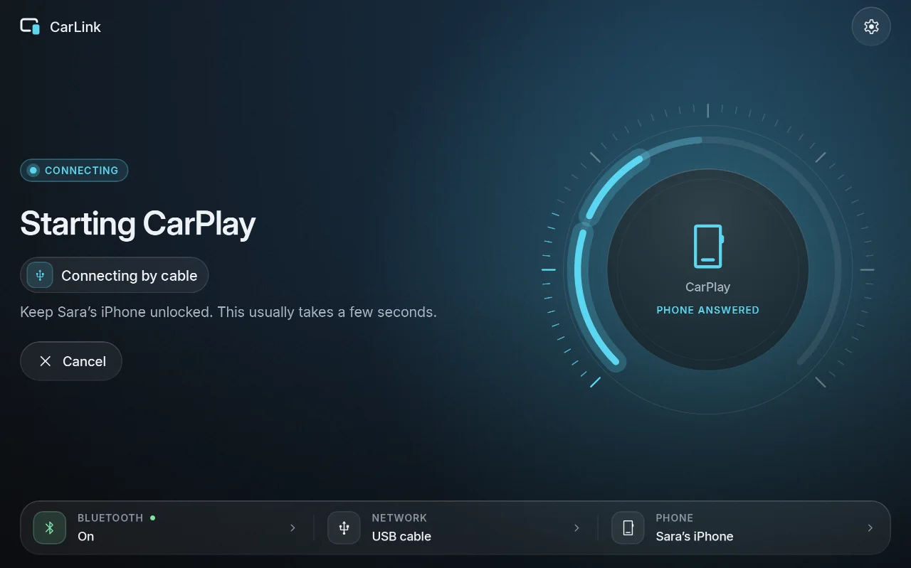</a> Connecting, step by step</td>
  </tr>
  <tr>
    <td><a href="docs/screenshots/switcher/switcher_panel_tablet_dark.webp">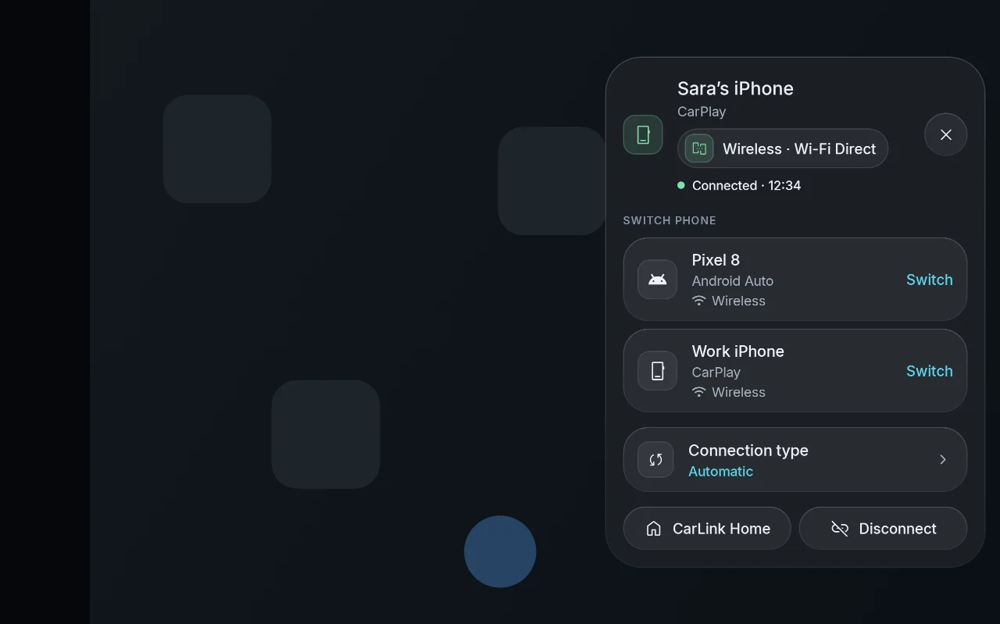</a> Floating switcher over CarPlay and Android Auto</td>
    <td><a href="docs/screenshots/home/home_connected-android-auto-usb_tablet_dark.webp">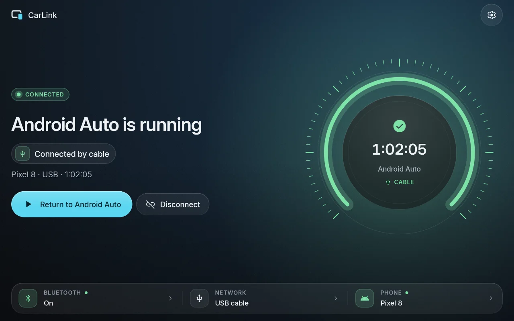</a> A running session</td>
  </tr>
  <tr>
    <td><a href="docs/screenshots/setup/setup_car_tablet_dark.webp">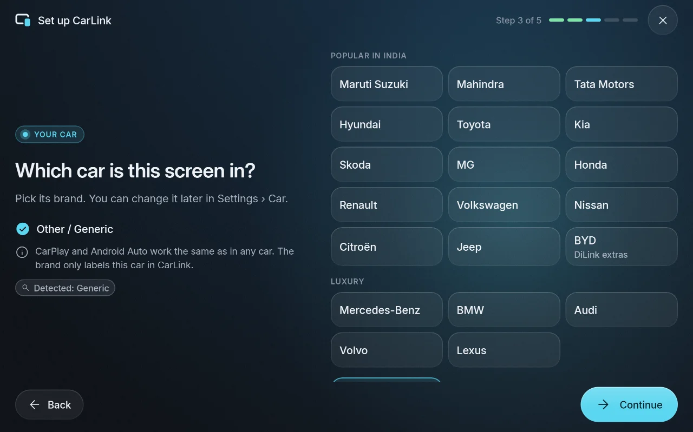</a> First-time setup: car brand</td>
    <td><a href="docs/screenshots/settings/settings_display-schedule_tablet_light.webp">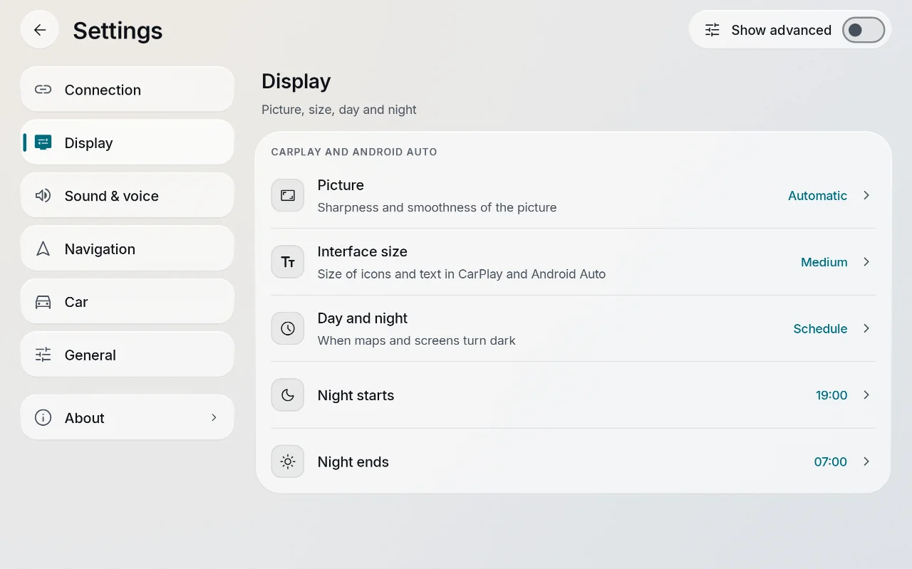</a> Settings (light theme)</td>
  </tr>
  <tr>
    <td><a href="docs/screenshots/update/update_available_tablet_dark.webp">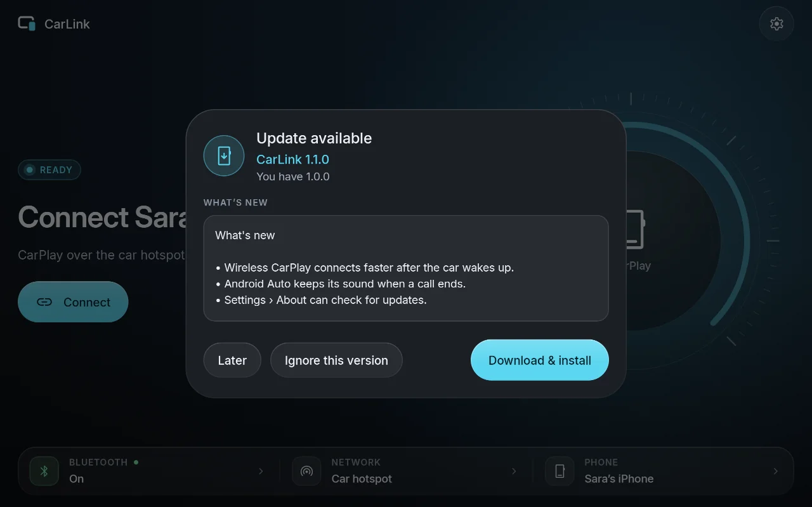</a> In-app update (sample release notes)</td>
    <td><a href="docs/screenshots/diagnostics/diagnostics_phones-card_tablet_dark.webp">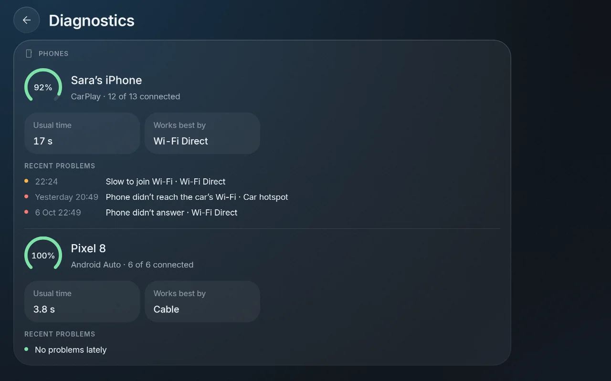</a> Diagnostics: each phone's connection health</td>
  </tr>
  <tr>
    <td><a href="docs/screenshots/home/home_ready-iphone-usual_car-landscape_dark.webp">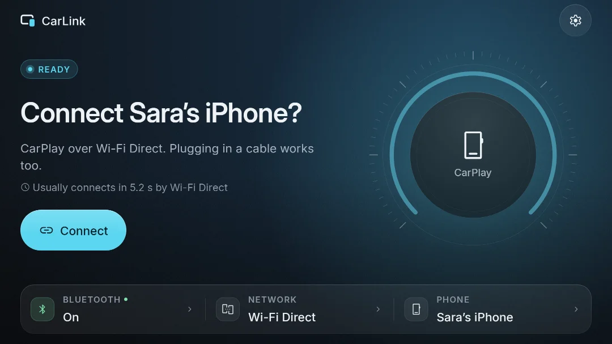</a> On a car display: larger targets and text</td>
    <td><a href="docs/screenshots/home/home_connected-carplay_headunit-1024x600_dark.webp">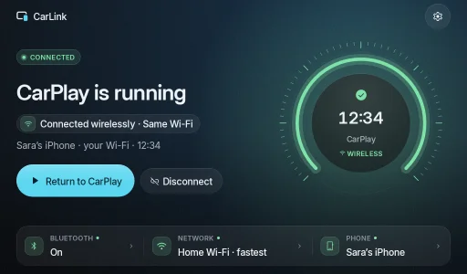</a> On a 1024×600 head unit</td>
  </tr>
</table>

Tablet screenshots above, car-display sizes in the last row. They are rendered from the app's
screens with sample data, not captured from a phone. Every screen and state, on every size:
[screenshot gallery](docs/screenshots/README.md).

## Features

- **Automatic detection.** iPhone → CarPlay, Android phone → Android Auto, from the USB device or
  the phone's Bluetooth services. Nothing to choose.
- **USB and wireless.** Wireless uses Wi-Fi Direct by default (no router or hotspot needed); the
  car's own hotspot and the same Wi-Fi network are options.
- **Plug and play.** Plugging in starts at once; the last phone reconnects by itself when CarLink
  comes to the front.
- **Switch phones.** A second phone asks "Switch to &lt;phone&gt;?" instead of taking over, and a
  floating switcher over CarPlay and Android Auto changes phones or returns to CarLink.
- **Simple by default, complete when you need it.** Home shows one status and one action, with a
  one-tap fix when something is wrong; **Show advanced** in Settings has every engine option.
- **Any Android head unit or tablet**, with car-display and phone/tablet layouts, dark and light.
- **Low-end mode.** Lite rendering on head units with little memory or processor power.
- **In-app updates** from GitHub Releases, checked before they are installed.
- **Car brands.** Pick your make (popular Indian makes, luxury makes, or Other); only BYD changes
  behaviour, turning on the DiLink extras.
- **Diagnostics** with device checks and a shareable connection log.

## Requirements

- **The display:** Android 7.1 or newer on ARM (`arm64-v8a` or `armeabi-v7a`): a car stereo, a
  tablet or a phone used as the car's display. Install CarLink there, not on your phone.
- **iPhone (CarPlay)** or **Android phone (Android Auto)**, with a USB cable, or with Bluetooth and
  Wi-Fi on for wireless. Wireless needs pairing once, started from the phone.

## Install

1. Open [Releases](https://github.com/F-e-n-y-x/CarLink/releases/latest) on the display (or on a
   computer, then copy the file over by USB stick or cable).
2. Download `CarLink-X.Y.Z.apk`. To check the file, compare its SHA-256 with the
   `CarLink-X.Y.Z.apk.sha256` file of the same release (`sha256sum -c CarLink-X.Y.Z.apk.sha256`).
3. Open the APK. Android asks you to allow installing apps from the browser or file manager you
   used ("Install unknown apps" › **Allow from this source**). Allow it, go back and tap
   **Install**.
4. Open CarLink and follow the first-time setup.

The release's package is `com.carlink.app`. It is signed with CarLink's own release key
(certificate SHA-256
`03:74:68:CA:5B:EB:70:EA:5F:68:54:33:29:B0:33:68:24:7D:FB:39:3D:3F:62:6A:6B:47:2D:10:E5:65:7D:21`;
how to check it with `apksigner`: [user guide](docs/USER_GUIDE.md#install)). An APK signed with
another key is not an official build and cannot update it.

## First-time setup

1. **Allow access.** CarLink asks for what it needs (Bluetooth, nearby Wi-Fi devices, location,
   microphone, notifications, display over other apps) with one **Allow all**.
2. **Choose your car.** Pick its brand, or Other. Only BYD changes anything.
3. **Pair from the phone.** On the phone, open Bluetooth settings and tap this display's name. A
   tablet cannot start the car-kit side of pairing itself, so pairing is always started on the
   phone. A cable works without pairing.
4. **Connect.** Tap **Connect** on Home (or plug in the cable). On the phone, accept "Use CarPlay"
   or Android Auto's prompt the first time. Keep the phone unlocked during the first connection.

Details: [user guide › First-time setup](docs/USER_GUIDE.md#first-time-setup).

## Updates

CarLink checks this repository's Releases at most **every 6 hours**, only while its own screen is
open and **no phone is connecting or connected**, and asks before downloading. Before installing,
it checks the download's SHA-256, package, version and signing key, and deletes it if any check
fails. **Settings › About** has **Check for updates** and turns the automatic checks off. Only
the official release updates itself; the only data sent is the request to GitHub's public API.
Details: [user guide › Updates](docs/USER_GUIDE.md#updates).

## What works and what's tested

What CarLink supports:

| | Over USB | Wirelessly |
|---|---|---|
| **CarPlay** (iPhone) | yes | yes: Wi-Fi Direct (default), the car's own hotspot, or the same Wi-Fi network (opt-in) |
| **Android Auto** (Android phone) | yes | yes: Wi-Fi Direct (default) or the same Wi-Fi network (opt-in) |

Proven on a real device, so far one: a Redmi Pad Pro 5G (Android 16) with an iPhone and a
Samsung Galaxy S25 Ultra, 2026-10-09:

- CarPlay over USB (about 3.4 s from plug-in to picture), Android Auto over USB (about 3.8 s),
  Android Auto over Wi-Fi Direct (about 5 s) and CarPlay over Wi-Fi Direct (about 16-20 s,
  mostly paging the iPhone over Bluetooth), and Android Auto over the same Wi-Fi network;
- CarPlay over the same Wi-Fi network failed on that router (it does not pass mDNS between
  clients; see [known limits](docs/USER_GUIDE.md#known-limits)).

**Not tested yet:** the car-hotspot path, other head units and tablets, and Android 7.1-9.
**The signed 1.0.0 release build has not been tested on a device yet**; the results above come
from development builds of the same code. This README will say so when it has been. Reports from
other head units are very welcome.

## FAQ

**Which phone gets what?** An iPhone always gets CarPlay and an Android phone Android Auto.
CarLink decides from the USB vendor ID or the phone's Bluetooth services, and remembers it.

**Do I need a router or the car's hotspot for wireless?** No. Wi-Fi Direct links the phone and the
display directly. During wireless Android Auto the phone's apps use mobile data, because that link
has no internet.

**Why doesn't my phone connect by itself when I get in?** A tablet is not a Bluetooth car kit, so
the phone never connects to it on its own; CarLink starts the last phone when its Home comes to
the front. A car head unit with hands-free roles is reconnected by the phone itself.

**Home says "Your iPhone couldn't reach this screen".** Your Wi-Fi router blocks the link CarPlay
needs. Tap **Use Wi-Fi Direct**, or use a cable.

**Does the car brand matter?** Only BYD changes anything (head-up display, instrument cluster,
steering-wheel keys). The brand never reaches the phone.

**Something doesn't work.** See [troubleshooting](docs/TROUBLESHOOTING.md) for every message
Home shows. To report a bug, use **Settings › General › Diagnostics › Share log** and
[open an issue](https://github.com/F-e-n-y-x/CarLink/issues/new/choose).

## CarPlay notice

> [!WARNING]
> CarLink is **not an Apple-certified product**. As in DiPlay's releases, the release APK bundles
> an experimental accessory identity recovered from public Carlinkit firmware, not a newly
> provisioned MFi identity for CarLink. A bundled private key is extractable. Acceptance after
> future iOS updates, reliability across head units and suitability of that identity for general
> distribution are unresolved: **there is no guarantee that CarPlay keeps working after an iOS
> update.** Builds from this source contain no accessory identity
> ([building](docs/BUILDING.md#carplay-authentication-files-not-in-git)). Android Auto does not
> depend on it.

## For developers

Building, architecture, the reusable `:carlink-core` library (for a launcher or another app),
releasing and the engine changes are in the [documentation index](docs/README.md):
[building](docs/BUILDING.md) · [architecture](docs/ARCHITECTURE.md) ·
[integration](docs/INTEGRATION.md) · [releasing](docs/RELEASING.md) ·
[contributing](CONTRIBUTING.md) · [security](SECURITY.md) · [changelog](CHANGELOG.md).
The project uses no GitHub Actions: tests run locally, and `scripts/release.sh` runs them before
every release.

## Credits

CarLink is built on two engines, both by [shihabal3amri](https://github.com/shihabal3amri), kept
with their full history:

- **[DiPlay](https://github.com/shihabal3amri/DiPlay)** (CarPlay), based on
  [xcertplay](https://github.com/shilapi/xcertplay) by shilapi: `vendor/diplay`.
- **[DiAuto](https://github.com/shihabal3amri/DiAuto)** (Android Auto), a fork of
  [Open Headunit](https://github.com/andreknieriem/open-headunit), based on Headunit Revived and
  [Michael Reid's headunit](https://github.com/mikereidis/headunit): `vendor/diauto`.

Thank you to the authors of both engines and of the projects they build on. CarLink's About
screen lists the other components and shows the full license texts.

## License

CarLink as a whole is distributed under the **GNU Affero General Public License v3.0**
([LICENSE](LICENSE)). If you distribute CarLink, or let people use it over a network, you must
offer its complete source code; every release is tagged in this repository (`vX.Y.Z`).

The engines keep their own licenses: DiPlay is GNU GPL v3.0 (`vendor/diplay/LICENSE`, as is
xcertplay) and DiAuto is GNU AGPL v3.0 (`vendor/diauto/LICENSE`). GPL v3 §13 allows combining
GPL-3.0 and AGPL-3.0 code; the combination is distributed under the AGPL-3.0.

## Trademarks

CarLink is not affiliated with or endorsed by Apple, Google or BYD. CarPlay is a trademark of
Apple Inc.; Android Auto is a trademark of Google LLC. BYD and DiLink belong to their owner. Other
car makes are named only to identify the car.
