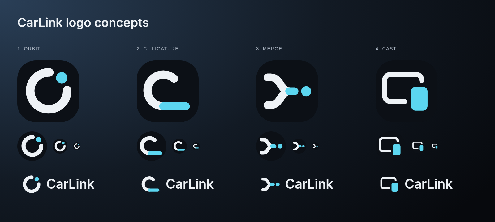
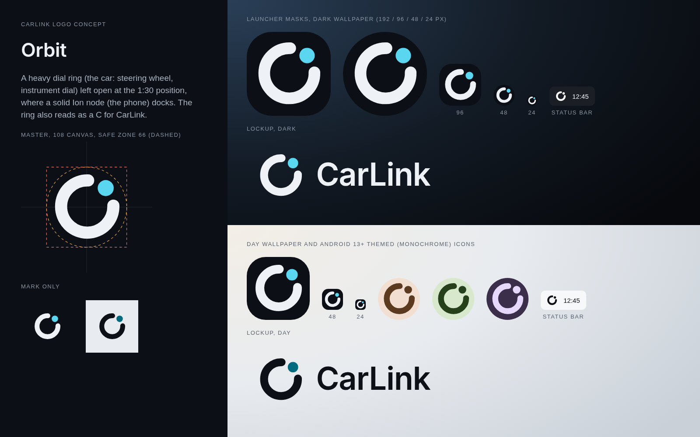
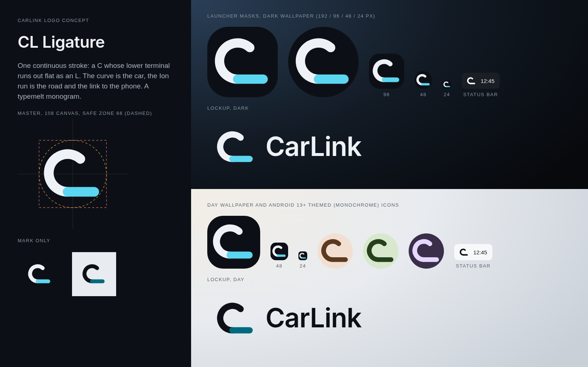
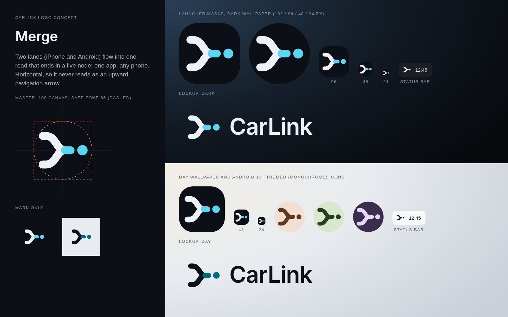
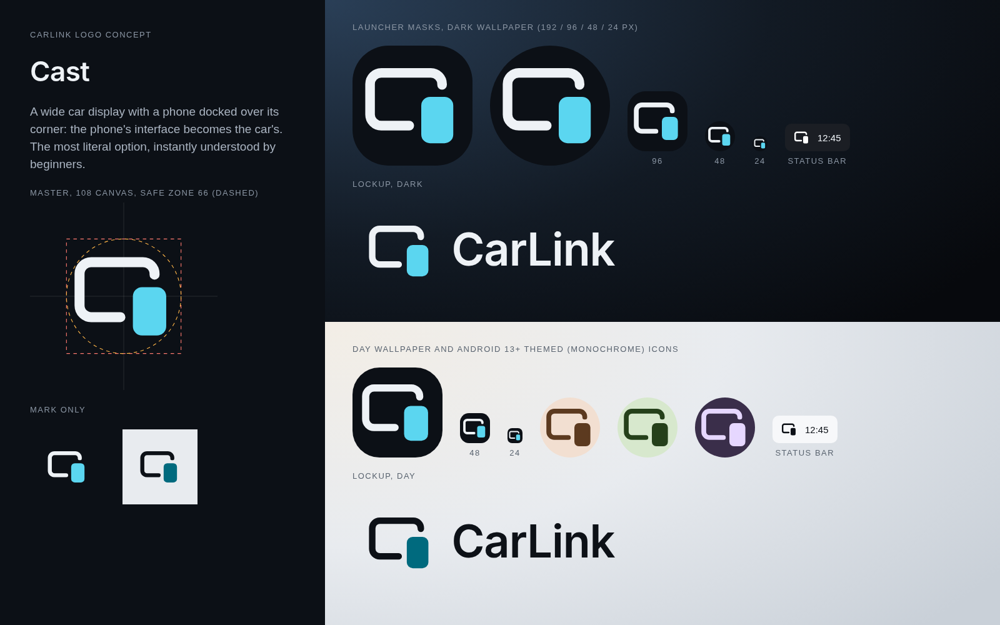

# CarLink logo: research, concepts and recommendation

Status: four concepts designed. Orbit was the first recommendation; the user chose **"Cast"**,
which is the logo the app ships (commit 42295f29). The README header and the social preview
(`docs/assets/`) use the Cast mark; `tools/social_preview.html` renders the preview.



## 1. Research

### 1.1 Marks CarLink must stay clear of (trademarks)

| Mark | What it is | What CarLink avoids |
|---|---|---|
| Android Auto | A rounded upward arrow, like a paper plane or an "A", on a circle. In version 17.6 (Sept 2026) it changed from blue to a flat green similar to the Android green, with rounder corners and no gradient ([Android Authority](https://www.androidauthority.com/google-android-auto-new-green-icon-3705210/), [9to5Google](https://9to5google.com/2026/09/01/android-auto-17-6-update-rolling-out-with-redesigned-logo-gallery/), [Droid Life](https://www.droid-life.com/2026/09/01/fresh-new-android-auto-logo-is-here/)) | Upward arrows and chevrons, "A" shapes, green as the main colour |
| Apple CarPlay | A white "play" triangle in a rounded square on green; Apple's HIG covers CarPlay *app* icons (one centred focal point, no black backgrounds) ([Apple HIG, CarPlay icons](https://developer-mdn.apple.com/design/human-interface-guidelines/technologies/carplay/icons-and-images)) | Play triangles, green, rounded-square framing inside the mark |
| Google Maps | The pin alone, without a "G", since 2020 ([Creative Bloq](https://creativebloq.com/news/google-maps-new-look)) | Location pins |
| Waze | A rounded "Wazer" speech bubble with wheels, redrawn by Pentagram (2020) on one geometric grid, with flat colour and rounded type ([Pentagram](https://www.pentagram.com/work/waze), [Creative Review](https://www.creativereview.co.uk/waze-rebrand/)) | Mascots and speech bubbles |
| BYD | A wordmark. Since 2021 it has no oval, and the letters are opened up "to link with users … in a more open posture" ([CnEVPost](https://cnevpost.com/2021/01/04/byd-auto-unveils-new-logo-in-brand-upgrade/)) | Letter "BYD" forms. CarLink runs on BYD DiLink but is independent of BYD |
| Rivian | A compass of four arrows, built from two nested rhombuses ([Rivian, "Our logo"](https://rivian.com/stories/our-logo), [MotorBiscuit](https://www.motorbiscuit.com/meaning-rivian-compass-logo/)) | Compass and four-arrow forms |
| Polestar | Two opposed angular forms making a four-point star, in restrained silver or grey ([1000logos](https://1000logos.net/polestar-logo/)) | Opposed chevrons |
| Tesla | A "T" drawn as a cross-section of an electric motor; the shield was dropped ([Not a Tesla App](https://www.notateslaapp.com/news/2115/teslas-logo-its-hidden-meaning-and-evolution-over-time), [Motor1](https://www.motor1.com/news/134480/elon-musk-tesla-logo-explained/)) | A single initial on its own |

Adapter and head-unit apps (Carlinkit Autokit, Ottocast, AAWireless, Motorola MA1, Headunit
Reloaded and Headunit Revived) have no public brand material. Their store icons are mostly
wordmarks, phone-plus-car pictograms or reworked CarPlay and Android Auto glyphs. That is the
category's main weakness: the icons look borrowed and generic. For context see
[Carlinkit's Autokit FAQ](https://carlinkitcarplay.com/pages/faq-en-autokit-for-aftermarket-android-screen-cars-version1-0),
[AAWireless](https://www.aawireless.io/en), [OTTOCAST](https://www.ottocast.com/) and
[Headunit Reloaded on AppGoblin](https://appgoblin.info/apps/gb.xxy.hr). Spotify's Car Thing
put a large **physical dial** at the centre of its industrial design
([TechCrunch](https://techcrunch.com/2022/02/22/spotifys-in-car-entertainment-device-car-thing-is-now-publicly-available),
[Pop Sci](https://www.popsci.com/gear/spotify-car-thing-smart-player)). In a car, a dial is the
interface people know best.

### 1.2 What premium automotive and EV marks share

- **Reduction.** Polestar, Rivian, Lucid and the 2021 BYD all moved away from chrome badges toward
  flat, single-colour geometry or wide minimal type
  ([Lucid on logos-world](https://logos-world.net/lucid-logo/),
  [1000logos EV brands](https://1000logos.net/most-famous-electric-car-brands-and-logos/)).
- **One idea, with a story.** Rivian's compass ("point you in the right direction"), Tesla's motor
  section, Polestar's pole star and BYD's "open" letters. Each is one simple geometric idea with a
  sentence of meaning behind it.
- **Monochrome first.** These marks work in a single colour on dark glass and metal. That matches
  Graphite and Ion, where colour is an accent, not the identity.

### 1.3 Logo-trend and platform guidance

- **LogoLounge 2025** (30,000+ logos) puts small screens first: "higher contrast, bolder color,
  and razor-sharp icons". Relevant named trends: *Smokies* (rounded ends, friendly), *Typemelts*
  (letters fused by rounded bridges), *Coves* (negative space completes the form), *SpinShift*
  (knob-like rotation), *Hoopty* (orbits that evoke navigation) and *Crossovers* (bridged and
  merged elements suggest connection)
  ([LogoLounge 2025](https://www.logolounge.com/trend/2025-logo-trend-report),
  [Alex Tass summary](https://alextass.com/logolounge-2025-logo-trend-report/)). The 2026 report
  names motion as the overarching theme
  ([Dieline](https://thedieline.com/logoloung-releases-its-2026-trend-report-and-everything-is-on-the-move/)).
- **Android adaptive icons.** The canvas is 108×108dp. The central 66×66dp safe zone is never
  clipped. The logo should be 48–66dp. Layers must have no baked masks or shadows. A monochrome
  layer is required for Android 13+ themed icons, and Android 16 QPR2 auto-themes apps that lack
  one ([Android developers, adaptive icons](https://developer.android.com/develop/ui/views/launch/icon_design_adaptive)).
- **Status-bar / notification icon.** 24×24dp with a ~22dp optical square. Only the alpha channel
  is used, so the icon must be a white silhouette with no colour and no text, and should share the
  launcher icon's metaphor ([Android 4.4 iconography archive](https://docs.huihoo.com/android/4.4/design/style/iconography.html),
  [OneSignal notification icons](https://documentation.onesignal.com/docs/notification-icons)).
- **Apple's app-icon guidance** (useful as general practice): one centred focal point, no text,
  recognisable at small sizes, and it must still read in dark and tinted modes
  ([Apple HIG, app icons](https://developer.apple.com/design/human-interface-guidelines/app-icons)).

### 1.4 Design brief derived from the research

1. One geometric idea that can be built from 2 to 4 primitives with rounded ends (Smokies). No
   text inside the icon.
2. Meaning: *connection between phone and car*, or *one app for any phone*. It must not use a
   chain (the rejected placeholder), a car silhouette (the wrong car is worse than none, per
   RESEARCH_PREMIUM_UX section 6.4), or an arrow.
3. A white mark (`#EEF2F6`) on Graphite (`#0C1016`), with **one** Ion element (`#5BD6F0`) for the
   "live link". This mirrors the app's rule that Ion marks the interactive or live thing. Day
   variant: ink `#0D1117` and accent `#006A7E`.
4. It must survive 24px, circle and squircle masks, and a single-colour themed tint. Every part
   needs clear space between elements, because colour is lost in monochrome.

## 2. Concepts

Each concept is defined once in `tools/build_logo.py`. The script writes every SVG, the boards and
the Android vectors from that definition. `tools/measure.py` renders each mark in Chrome and
checks the ink bounding box, the optical centroid, and that every ink pixel lies inside the
33-unit safe-zone circle. Final measurements:

| Concept | Mark size (of 108) | Farthest ink from centre (limit 33) |
|---|---|---|
| 1 Orbit | 53 × 53 | 28.8 |
| 2 CL Ligature | 54 × 47 | 32.1 |
| 3 Merge | 55 × 41 | 32.5 |
| 4 Cast | 53 × 45 | 32.4 |

### 1. Orbit (recommended, implemented)


A heavy dial ring stands for the car: a steering wheel, an instrument dial, the Car Thing knob.
It is open at the 1:30 position, where a solid Ion node, the phone, docks into it. The ring
also reads as a **C** for CarLink. Ideas: *SpinShift* and *Hoopty* (dial and orbit), *Coves*
(the gap completes the C).

### 2. CL Ligature


A single stroke: a **C** whose lower end runs out flat as the foot of an **L**. The curve is the
car, and the flat Ion run is the road or link. This is a *Typemelt* monogram.

### 3. Merge


Two lanes (iPhone and Android) merge into one road that ends in a live node: *one app, any
phone*. It is horizontal on purpose, so it never reads as an upward navigation arrow like the
Android Auto mark.

### 4. Cast


A wide car display with a phone docked over its corner: the phone's interface becomes the car's.
This is the most literal option.

## 3. Recommendation: Orbit

- **The strongest silhouette at 24px and in the status bar.** It is one closed, heavy form with
  one node. In the boards it stays crisp at 24px, in both masks and in all three themed tints.
- **The most ownable of the four.** It has no arrow, triangle, pin, chain, star or car body. In
  the research set, only Rivian (a compass) works in a similar "instrument" space, and its form
  is different.
- **The meaning fits the product.** CarLink is the dial (the car) that the phone clicks into.
  The node is the only Ion element, which matches the UI rule that Ion marks what is live or
  interactive. It can later animate on the splash screen, which supports the 2026 motion trend:
  the node travels round the ring and docks.
- **It sits well next to the Inter SemiBold wordmark.** The ring echoes the bowls of "C", "a"
  and "r".

Risk to keep in mind: an open ring can be read as a loading spinner or a refresh glyph. This is
most likely on the splash screen and at top-bar size. The heavy stroke (10/108) and the
detached solid node reduce this, but the user should look at it on the car. If it bothers them,
**Merge** is the most distinctive alternative. **Cast** is the clearest for beginners but the
least ownable, because device-pair pictograms are common, e.g. phone-and-PC link apps and the
Material "devices" icon. **CL Ligature** reads mostly as a "C" with an underline.

## 4. Files

| Path | What |
|---|---|
| `concepts/<id>_icon.svg` | Full icon (Graphite background and mark), 108 canvas |
| `concepts/<id>_mark.svg`, `_mark_day.svg` | Transparent mark, dark and day colours |
| `concepts/<id>_mono.svg` | Single-colour mark |
| `concepts/<id>_lockup_dark.svg`, `_lockup_day.svg` | Horizontal lockup with the "CarLink" wordmark. The wordmark uses the bundled Inter SemiBold through `@font-face`, for preview only. Convert it to outlines in a vector editor before using it outside this repo |
| `previews/<id>_board.png` | Presentation board: masks, sizes, themed icons, status bar, lockups |
| `previews/overview_board.png` | All four side by side |
| `previews/emulator_*.png` | Orbit verified on the emulator (splash, Home top bar, app drawer) |
| `android/<id>/` | Complete drawable set per concept: `carlink_icon_foreground/monochrome/legacy.xml`, `ic_stat_carlink.xml`, `carlink_logo_mark_{primary,accent}.xml` |
| `android/carlink_logo_alt{1,2,3}_{foreground,monochrome}.xml` | Alternates: 1 = CL Ligature, 2 = Merge, 3 = Cast |
| `tools/build_logo.py`, `tools/measure.py`, `tools/render.sh` | Generator, safe-zone and centroid checker, board renderer |

### How to swap the logo in the app

```sh
cp design/logo/android/merge/*.xml app/src/main/res/drawable/   # or ligature / cast / orbit
.claude/skills/carlink-dev/scripts/dev.sh build && .claude/skills/carlink-dev/scripts/dev.sh install
```

The same file names are kept, so the manifest, the adaptive icon (`mipmap-anydpi-v26`), the
notification (`HomeLauncher`) and the in-app mark (`CarLinkMark` in `ui/components/Components.kt`,
which tints `carlink_logo_mark_primary` with `onSurface` and `carlink_logo_mark_accent` with the
Ion primary) all pick up the change. To change geometry, edit the concept in `build_logo.py`,
then run `python3 design/logo/tools/build_logo.py && python3 design/logo/tools/measure.py <tmpdir>
&& python3 design/logo/tools/build_logo.py && design/logo/tools/render.sh`, and look at the boards.
